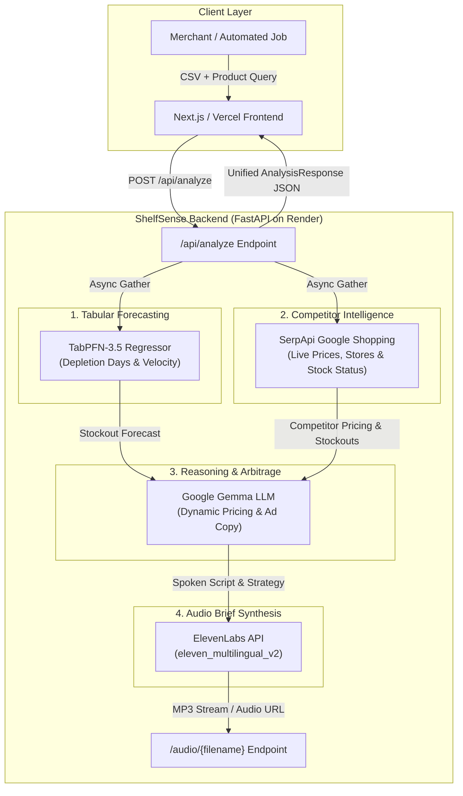

# ShelfSense 🚀
### E-Commerce Inventory Arbitrage & Stockout Detection Engine

**ShelfSense** is a high-throughput, production-ready backend service designed for high-volume Shopify and Amazon merchants. It predicts internal inventory depletion with state-of-the-art tabular foundation models, continuously crawls real-time competitor prices and stockouts, synthesizes dynamic pricing arbitrage playbooks with Google Gemma, and delivers a personalized 60-second morning audio brief synthesized by ElevenLabs.

---

## 🏛️ System Architecture



---

## ⚡ Core Engines & Capabilities

| Component | Technology | Description |
| :--- | :--- | :--- |
| **Tabular Regression** | **TabPFN (TabPFN-3.5)** | Foundation model for tabular regression. Predicts remaining stockout days and velocity from historical rows $(N-1)$ to target row $(N)$. Categorizes risk (`Immediate`, `High`, `Moderate`, `Low`). |
| **Competitor Crawler** | **SerpApi (Google Shopping)** | Crawls real-time competitor prices, merchant names (Amazon, Walmart, Target, etc.), star ratings, and detects out-of-stock indicators. |
| **Reasoning & Arbitrage** | **Google Gemma (`gemma2`)** | Algorithmic e-commerce arbitrage director: evaluates stockout pressure, triggers +10%–20% surge pricing when competitors stock out, drafts 3 punchy ad headlines (<30 chars), and formulates action steps. |
| **Spoken Brief** | **ElevenLabs Voice AI** | Generates a crisp, natural 60-second morning spoken brief addressing the merchant directly using `eleven_multilingual_v2`. |
| **High-Throughput API** | **FastAPI + Uvicorn** | Fully asynchronous non-blocking pipeline with CORS enabled for Next.js / Vercel web applications. |

---

## 📂 Repository Directory Layout

```text
shelfsense-backend/
├── app/
│   ├── __init__.py
│   ├── main.py                 # FastAPI application entrypoint & routing
│   ├── config.py               # Pydantic BaseSettings for env vars & validation
│   ├── schemas.py              # Pydantic request/response validation schemas
│   ├── services/
│   │   ├── __init__.py
│   │   ├── tabpfn_service.py   # TabPFN client inference & dataset validation
│   │   ├── serp_service.py     # SerpApi Google Shopping crawler & parsing
│   │   ├── gemma_service.py    # Gemma LLM client, prompt templates, and structured parsing
│   │   └── audio_service.py    # ElevenLabs text-to-speech audio stream generation
│   └── utils/
│       ├── __init__.py
│       └── logger.py           # Structured logging
├── static/
│   └── audio/                  # Cached/generated mp3 files
├── tests/
│   ├── __init__.py
│   └── test_pipeline.py        # Integration test for the end-to-end pipeline
├── sample_inventory.csv        # Sample historical inventory CSV for testing
├── render.yaml                 # Render blueprint configuration
├── requirements.txt            # Python dependencies with pinned versions
├── .env.example                # Environment variables template
└── README.md
```

---

## 🛠️ Getting Started Locally

### 1. Clone & Set Up Virtual Environment

```bash
git clone https://github.com/AdityaNarayanPadhi/SelfSense.git
cd SelfSense

python -m venv venv
# On Linux / macOS:
source venv/bin/activate
# On Windows:
venv\Scripts\activate

pip install -r requirements.txt
```

### 2. Configure Environment Variables

Copy `.env.example` to `.env`:
```bash
cp .env.example .env
```

Ensure your API keys are configured:
```ini
SERPAPI_API_KEY=your_serpapi_key_here
TABPFN_API_KEY=your_tabpfn_key_here
ELEVENLABS_API_KEY=your_elevenlabs_key_here
ELEVENLABS_VOICE_ID=21m00Tcm4TlvDq8ikWAM
GEMMA_API_BASE=http://localhost:11434
GEMMA_MODEL_NAME=gemma2
ALLOWED_ORIGINS=*
PORT=8000
```

### 3. Run FastAPI Development Server

```bash
uvicorn app.main:app --host 0.0.0.0 --port 8000 --reload
```

Interactive OpenAPI Swagger UI is available at:
`http://localhost:8000/docs`

---

## 🧪 Running Integration Tests

Run the comprehensive pytest suite:

```bash
pytest -v tests/test_pipeline.py
```

Tests validate:
- Direct TabPFN tabular prediction and edge-case handling
- Missing column and non-CSV input rejection
- End-to-end `/api/analyze` response contracts
- 30-character ad headline constraints
- ElevenLabs MP3 streaming and 404 validation

---

## 📡 API Reference

### 1. Service Health Check
`GET /health`

**Response:**
```json
{
  "status": "ok",
  "service": "shelfsense-api"
}
```

---

### 2. E-Commerce Inventory & Arbitrage Analysis
`POST /api/analyze`

**Request:** `multipart/form-data`
- `product_query` (string, required): Product title or search query (e.g. `"Sony WH-1000XM5 Wireless Headphones"`).
- `csv_file` (file, required): Historical inventory depletion `.csv` file.

#### Expected CSV Format:
```csv
units_sold_7d,price_delta,stock_remaining,days_until_stockout
12,0.0,48,28.0
15,-1.5,39,18.2
22,2.0,28,8.9
29,4.0,14,3.4
34,6.0,5,1.0
```

#### Example cURL Command:
```bash
curl -X POST "http://localhost:8000/api/analyze" \
  -F "product_query=Sony WH-1000XM5 Wireless Headphones" \
  -F "csv_file=@sample_inventory.csv"
```

#### Response Example (`200 OK`):
```json
{
  "product_query": "Sony WH-1000XM5 Wireless Headphones",
  "forecast": {
    "predicted_stockout_days": 1.0,
    "current_inventory": 5,
    "sales_velocity_7d": 34,
    "risk_level": "Immediate"
  },
  "competitors": [
    {
      "title": "Sony WH-1000XM5 Wireless Headphones - Black",
      "price": 398.00,
      "source": "Amazon",
      "in_stock": true,
      "rating": 4.6
    },
    {
      "title": "Sony WH-1000XM5 Headphones Official",
      "price": 399.99,
      "source": "Best Buy",
      "in_stock": false,
      "rating": 4.5
    }
  ],
  "strategy": {
    "suggested_price_delta_percent": 15.0,
    "new_suggested_price": 458.85,
    "ad_headlines": [
      "In Stock Now - Ships Today",
      "Official Stock Guarantee",
      "Skip The Sold Out Queues"
    ],
    "action_steps": [
      "Increase list price by 15.0% to $458.85 to capitalize on competitor stockouts.",
      "Surge Google Shopping ad budget by 35% targeting competitor out-of-stock search terms.",
      "Contact supplier immediately to expedite reorder of inventory before 7-day depletion."
    ],
    "spoken_script": "Good morning. ShelfSense intelligence update for Sony WH-1000XM5 Wireless Headphones. Key competitors are currently out of stock while our inventory depletion model forecasts 1.0 days of runway. We recommend increasing price by fifteen percent to 458.85 dollars and surging ad spend by thirty-five percent today."
  },
  "audio_url": "/audio/3fa85f64-5717-4562-b3fc-2c963f66afa6.mp3"
}
```

---

### 3. Stream Morning Spoken Brief
`GET /audio/{filename}`

- Returns `audio/mpeg` streaming response for frontend HTML5 `<audio>` players.

---

## 🚀 Deployment on Render

This repository includes a native [`render.yaml`](render.yaml) blueprint specification:

```yaml
services:
  - type: web
    name: shelfsense-api
    env: python
    plan: starter
    buildCommand: pip install -r requirements.txt
    startCommand: uvicorn app.main:app --host 0.0.0.0 --port $PORT
    envVars:
      - key: PYTHON_VERSION
        value: 3.11.0
      - key: SERPAPI_API_KEY
        sync: false
      - key: TABPFN_API_KEY
        sync: false
      - key: ELEVENLABS_API_KEY
        sync: false
```

### Steps to Deploy:
1. Connect this GitHub repository (`https://github.com/AdityaNarayanPadhi/SelfSense.git`) to your **Render** dashboard.
2. Select **Blueprints** and Render will automatically detect `render.yaml`.
3. Add your production secret keys in the Render environment settings (`SERPAPI_API_KEY`, `TABPFN_API_KEY`, `ELEVENLABS_API_KEY`).
4. Click **Apply Blueprint** to launch the service.

---

## 🌐 Next.js / Vercel Frontend Integration

In your Next.js application, invoke the ShelfSense backend:

```typescript
const formData = new FormData();
formData.append("product_query", "Sony WH-1000XM5 Wireless Headphones");
formData.append("csv_file", selectedFile);

const response = await fetch("https://shelfsense-api.onrender.com/api/analyze", {
  method: "POST",
  body: formData,
});

const data = await response.json();
console.log("Arbitrage Playbook:", data.strategy);

// Play the ElevenLabs morning brief:
const audio = new Audio(`https://shelfsense-api.onrender.com${data.audio_url}`);
audio.play();
```

---

## 📄 License
MIT License. Built for high-performance e-commerce sellers.
